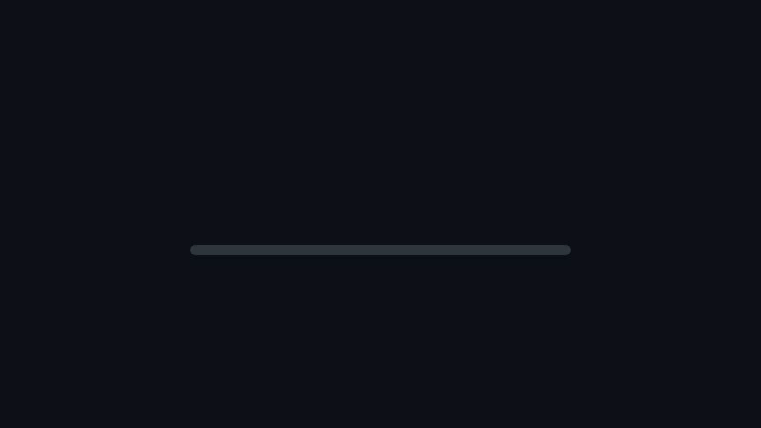

# howfar



A progress bar for AI coding agents: Claude Code, Codex CLI, Gemini CLI, or any agent that can run shell commands.

The agent reports its own progress by running a command. The bar shows percent, current step, a time estimate and a milestone checklist:

```
Build howfar
[###########---------] 55%
ETA: ~4m 10s left   elapsed 5m 05s
Current: Docs and agent files

  ✓ Core script (30)
  ✓ Tests (25)
  → Docs and agent files (20)
  ○ Repo files (5)
  ○ Demo and verify (10)
  ○ Commit (10)
```

**Honest note:** the percent is the agent's own estimate from the milestone weights it chose. It is not a measurement. A milestone weighted 30 can take 5% of the time. The ETA assumes the remaining work goes at the same pace as the finished work.

## Claude Code plugin (CLI and desktop app)


The quickest setup. At the Claude Code prompt in a terminal:

```
/plugin install howfar --marketplace deeihen/howfar
```

From a shell: `claude plugin install howfar --marketplace deeihen/howfar`. In the desktop app's Code tab: click **+** next to the prompt box, then **Plugins**, **Add marketplace** with `deeihen/howfar`, then **Add plugin**.

The plugin needs Python 3 on your PATH. It then:

- tells the agent to report progress with `howfar.py` (no CLAUDE.md block or settings to edit)
- draws the bar above the prompt, in the terminal and in the desktop app
- hides a plan left over from an earlier prompt, so the bar always belongs to the current task

The plugin reads `progress.json` in the session's folder, so `HOWFAR_FILE` is not supported there. Where an organization manages Claude Code, installed plugins can't add instructions to the agent's prompt; add the instruction block below to `CLAUDE.md` instead.

## Manual setup

1. Python 3, standard library only. Copy `howfar.py` into your project or anywhere on disk.
2. Paste the instruction block below into your agent's instruction file (`CLAUDE.md`, `AGENTS.md` or `GEMINI.md`).
3. Show the bar: a status line in Claude Code, or `watch` in a second pane for other agents.

State is stored in `./progress.json`. Set `HOWFAR_FILE` to use another path. Writes are atomic.

## Commands

| Command | What it does |
|---|---|
| `plan "Task" "Step:weight" ...` | Start a task with weighted milestones (integer weights). |
| `start "Step"` | Set the current step. Case-insensitive; exact match first, then prefix. |
| `done "Step"` | Mark a milestone finished, clear any manual override, move to the next unfinished step. |
| `set 68 "text"` | Manual percent override (clamped 0 to 100) with optional step text. |
| `show` | Print the full view once. |
| `line` | One short line for status bars. |
| `watch` | Redraw the full view every second until Ctrl-C. |
| `--version` | Print the version. |

Percent = done weights / total weight, rounded. ETA = elapsed × (100 − percent) / percent. Unknown commands or steps exit with code 1.

## Instruction block for CLAUDE.md, AGENTS.md or GEMINI.md

```markdown
## Progress reporting (howfar)

Report your progress on every multi-step task with `howfar.py`:

1. Before any work, run `python3 howfar.py plan "<task>" "<Milestone>:<weight>" ...` with 4 to 8 milestones whose weights add up to 100. Weight each milestone by expected effort.
2. Run `python3 howfar.py start "<Milestone>"` before you begin a milestone.
3. Run `python3 howfar.py done "<Milestone>"` after it is finished. Only mark a milestone done when it actually works (code runs, tests pass), not when you have merely written it.
4. If the scope changes, run `plan` again with the new milestones instead of bending the old ones.
5. Use `python3 howfar.py set <percent> "<text>"` only for a rough manual correction; the next `done` clears it.
```

Adjust the path to `howfar.py` if it is not in the project root.

## Claude Code status line

Add to `~/.claude/settings.json` or `.claude/settings.json` in your project:

```json
{
  "statusLine": {
    "type": "command",
    "command": "python3 /full/path/to/howfar.py line"
  }
}
```

The status line runs in the project directory, so it reads that project's `progress.json`. On Windows use `python` or `py` instead of `python3`.

## Codex CLI and Gemini CLI

They have no status line under the input. Run the live view in a second terminal pane or tmux split, in the same project directory:

```sh
python3 howfar.py watch
```

`watch` waits for a plan if none exists yet, so you can start it before the agent.

## Tests

```sh
python3 -m unittest -v test_howfar
```

## License

MIT
